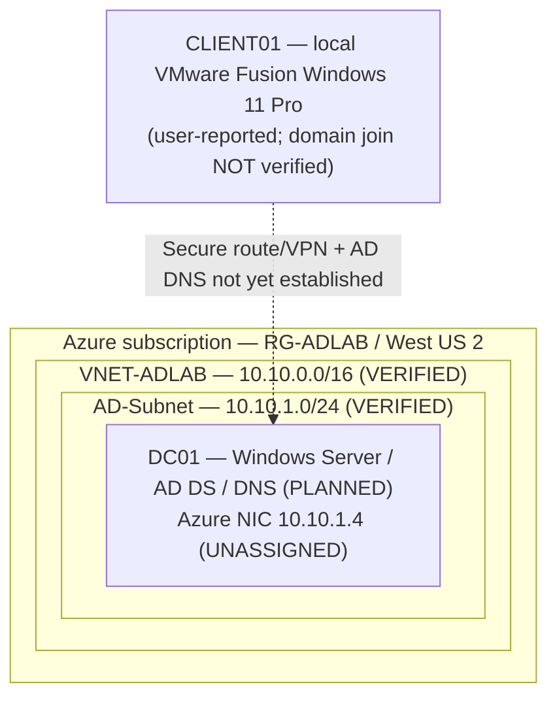

# Enterprise Active Directory Help Desk Lab

**Portfolio status — Azure foundation in progress:** Resource group `RG-ADLAB`, virtual network `VNET-ADLAB`, and subnet `AD-Subnet` have been **created and verified using Azure Portal screenshots**. Domain controller, Active Directory, secure local-client connectivity, and Help Desk tickets are **not yet implemented or verified**.

A practical enterprise IT support simulation built around **Windows Server Active Directory Domain Services (AD DS)**, **DNS**, **Windows 11**, **Group Policy**, **Jira-style ticket handling**, and safe PowerShell automation. The goal is to demonstrate the daily responsibilities of a Tier 1 Help Desk / Desktop Support Technician through reproducible tasks and **verified** troubleshooting evidence.

> **Business scenario (fictional):** **Apex Technologies** is a proposed ~50-employee company with IT, Finance, Human Resources, Sales, Operations and Management departments. The original 25-user, five-department test-data CSV remains intact but is not yet imported; it will be revised after the AD OU design is approved. No real employee data is used.

## Quick status

| Capability | Planned work | Verified implementation |
| --- | --- | --- |
| Azure networking | `RG-ADLAB`, `VNET-ADLAB` (`10.10.0.0/16`), `AD-Subnet` (`10.10.1.0/24`) | **Deployed and visually verified** — [evidence](#verified-azure-networking--october-19-2026) |
| Domain services | Windows Server 2022 `DC01`, AD DS, `adlab.test` forest, AD-integrated DNS | **Not deployed/configured**; proposed static private IP `10.10.1.4` remains unassigned |
| Client | CLIENT01, user-reported local VMware Fusion Windows 11 Pro client | VM setup **user-reported**; Azure connectivity/domain join not verified |
| Directory administration | Proposed 6 departmental OUs, role groups, ~50 fictional users (existing 25-user seed preserved) | **Design only**; no AD accounts created |
| Endpoint / policy | GPO restrictions, domain join/rejoin, permissions | **Not configured or tested** |
| Service desk | Twelve foundational tickets and 30-day [Enterprise Help Desk Academy](docs/academy/README.md) with 30 planned incidents | Scenarios documented; **no incident resolution claimed** |
| Automation | PowerShell plan/dry-run user creation, read-only reporting | Source code only; execution evidence pending |
| Quality controls | Static tests and GitHub Actions | [Initial offline CI run passed](https://github.com/dbates91/enterprise-active-directory-helpdesk-lab/actions/runs/38294061409); no AD or Azure validation claimed |

## Verified Azure networking — October 19, 2026

**Step 2: Completed.** An actual Azure deployment and post-deployment portal checks demonstrate the following configuration:

| Configuration | Observed result | Verification |
| --- | --- | --- |
| Resource group | `RG-ADLAB` | Azure Resource groups list |
| Region | West US 2 | VNet Overview |
| Virtual network | `VNET-ADLAB` | Deployment record and VNet Subnets blade |
| VNet IPv4 address space | `10.10.0.0/16` | VNet Overview |
| Subnet | `AD-Subnet` — `10.10.1.0/24` | Deployed Subnets blade |
| Available subnet addresses | 251 | Deployed Subnets blade |
| DNS service | Azure-provided DNS | VNet Overview; custom AD DNS not configured yet |
| Resource tag | `Project = Azure-AD-HelpDesk-Lab` | VNet Overview |
| Subnet NSG | None shown | Deployed Subnets blade; security design pending |
| DC01 private IP | `10.10.1.4` proposed | **Not assigned; VM does not exist yet** |

### Screenshot evidence

| Evidence | What the screenshot actually establishes |
| --- | --- |
| [01 — Resource group configuration](screenshots/01-resource-group-configuration.png) | Planned resource group, Region and project tag |
| [02 — Resource group created](screenshots/02-resource-group-created.png) | `RG-ADLAB` exists in the selected subscription and Region |
| [03 — Subnet configuration](screenshots/03-ad-subnet-configuration.png) | Planned `AD-Subnet` starting address and `/24` size before deployment |
| [04 — Successful VNet deployment](screenshots/04-vnet-deployment-success.png) | Azure reports deployment complete (correlation ID redacted) |
| [05 — VNet Overview](screenshots/05-vnet-overview-.png) | Deployed VNet address space, Region, DNS, project tag (resource IDs redacted) |
| [06 — Subnet verified](screenshots/06-ad-subnet-verified.png) | `AD-Subnet` really exists with `10.10.1.0/24` and 251 available IPs |

These are **real portal screenshots** from the Azure lab. Creation-wizard images establish configuration intent; post-deployment screenshots establish what Azure actually created. See the [evidence index](screenshots/README.md) and [project tracker](PROJECT_TRACKER.md).

**Security and cost scope:** The VNet and subnet alone do not demonstrate secure administration or a working domain. The subnet was configured with private-subnet behavior enabled; no subnet-level NSG was shown. The chosen secure management path, outbound access, VM cost, Windows licensing and trial-credit controls still require review **before DC01 deployment**.

## Target domain architecture — planned resources distinguished from deployed networking



The VNet and subnet shown above are **deployed and screenshot-verified**. DC01, the domain, and the secure connection from VMware remain **design targets**, not working services. This uses self-managed Windows Server AD DS in Azure VMs; it is **not Microsoft Entra ID** and **not Microsoft Entra Domain Services**. Use a private static Azure NIC address for DC01, configure the VNet DNS resolver for the DC, and refresh DHCP/DNS settings on clients. Avoid exposing RDP (TCP 3389) or domain-controller ports to the internet. [Full design](architecture/README.md).

**Windows 11 client:** CLIENT01 is a user-reported local VMware Fusion Windows 11 Pro installation. Verify the local Windows license and private Azure routing; do **not** deploy a second paid Azure Windows VM merely to satisfy the design. If considering an Azure-hosted client later, evaluate licensing/eligibility first. [Lab setup](docs/deployment/AZURE_DEPLOYMENT_PLAN.md).


**Connectivity design correction:** The Windows 11 Pro client is **local to VMware Fusion** and is not part of an Azure subnet. It requires an approved routed/VPN connection and DNS configuration to join `adlab.test`; paid VPN Gateway/Bastion or a second Azure VM must not be provisioned without cost/licensing review. No tunnel is verified.

## Planned Active Directory structure

- **Domain:** `adlab.test` (reserved example `.test` namespace for an isolated lab).
- **Proposed Apex Technologies departments:** `IT`, `Finance`, `HumanResources`, `Sales`, `Operations`, `Management`, with dedicated Users/Groups/Computers containers; see [new OU proposal](docs/academy/APEX_TECHNOLOGIES.md).
- **Proposed role groups:** `GG-IT-Support`, `GG-Finance-Users`, `GG-HR-Users`, `GG-Sales-Users`, `GG-Operations-Users`, `GG-Management-Users`; existing legacy CSV group values preserved as historical seed data.
- **Test identities:** [25 old fictional seed records](data/lab-users.csv) are kept as source samples; new ~50-user roster to be developed before lab import. No AD accounts currently verified.

## Help Desk skills to demonstrate

1. Identity verification and account unlocks or password resets using approved procedures.
2. Onboarding, department transfers, access group changes and offboarding.
3. Diagnosing domain sign-in failures without randomly resetting accounts.
4. Testing DNS A/CNAME resolution, secure domain joins and Group Policy application.
5. Handling permission issues and distinguishing share permissions from NTFS permissions.
6. Recording ticket intake, business impact, investigation, remediation, verification, escalation and closure.
7. Safe PowerShell admin scripting with explicit execution approval and no hard-coded passwords.

## Core lab workflow

**Learn → Build → Troubleshoot → Explain → Repeat.** Complete each ticket in guided mode, repeat with fewer hints, then perform a blind break/fix and an interview summary. Use the [ticket index](docs/tickets/README.md), [project roadmap](PROJECT_ROADMAP.md), and [tracker](PROJECT_TRACKER.md). Phase 0 remains **In Progress**, with Step 2 networking **Completed**; do not mark subsequent phases complete until their own changes and verification evidence exist.

### Safe initial local checks (no Azure account required)

```bash
python3 -m unittest discover -s tests -p 'test_*.py' -v
```

PowerShell examples are [documented here](scripts/powershell/README.md). `New-LabUsers.ps1` is **preview-only by default** and requires explicit `-Execute` to create **disabled** accounts in an authorized AD lab. No passwords, live identities, or Azure deployment credentials are in this repository.

## Project roadmap and navigation

| Location | Contents |
| --- | --- |
| [PROJECT_ROADMAP.md](PROJECT_ROADMAP.md) | Milestone-by-milestone build and evidence gates |
| [Step 2 — Verified Azure network](architecture/STEP_02_VNET_AND_SUBNET.md) | Completed deployment, CIDR explanation, screenshot checks and networking decisions |
| [30-day Enterprise Help Desk Academy](docs/academy/README.md) | 30 days, seven categories, 30 tickets, three difficulty levels, scoring and final assessment |
| [PROJECT_TRACKER.md](PROJECT_TRACKER.md) | Verified status/evidence log |
| [architecture/](architecture/README.md) | AD architecture, network and permission boundaries |
| [docs/deployment/](docs/deployment/README.md) | Azure account/VM/AD prerequisites, approval and teardown |
| [docs/tickets/](docs/tickets/README.md) | Twelve help desk scenario specifications |
| [docs/runbooks/](docs/runbooks/README.md) | Repeatable onboarding, lockout, DNS and incident workflows |
| [docs/group-policy/](docs/group-policy/README.md) | GPO objectives and verification methods |
| [scripts/powershell/](scripts/powershell/README.md) | Safe AD PowerShell lab scripts |
| [data/](data/README.md) | Synthetic user-data seed and schema |
| [screenshots/](screenshots/README.md) | Sanitized screenshots and evidence handling |
| [docs/portfolio/](docs/portfolio/CASE_STUDY.md) | Interview case study with actual-evidence placeholders |
| [COST_AND_SECURITY.md](COST_AND_SECURITY.md) | Azure spend, security and teardown guardrails |

## Definition of done

A completed ticket must include: user identity verification (when relevant), symptoms and scope, least-privilege assessment, relevant commands/GUI paths, evidence of investigation, change authorization, result and validation, accurate ticket notes, and a short interview explanation. Never invent deployments, successful tests, resolved tickets, or certification results.

## Current project status

**Azure resource group, VNet and subnet verified and screenshot evidence published.** Windows Server/DC01, AD DS, client domain join, secure Azure-to-local connectivity, and Help Desk tickets remain unimplemented. Offline repository checks passed; no Azure VM spend or active domain is claimed. Proceed through the [eight GitHub phase issues](https://github.com/dbates91/enterprise-active-directory-helpdesk-lab/issues) and verify licensing, security and costs before any VM deployment. The next milestone is reviewing Windows Server compute cost, subscription credit, a secure administration/outbound network design, and VM teardown **before** creating paid infrastructure.

### Primary Microsoft references

- [Install AD DS on Azure VM](https://learn.microsoft.com/en-us/windows-server/identity/ad-ds/deploy/virtual-dc/adds-on-azure-vm)
- [Windows 11 Azure eligibility](https://learn.microsoft.com/en-us/azure/virtual-machines/windows/windows-desktop-multitenant-hosting-deployment)
- [Azure budget alerts](https://learn.microsoft.com/en-us/azure/cost-management-billing/costs/tutorial-acm-create-budgets)
