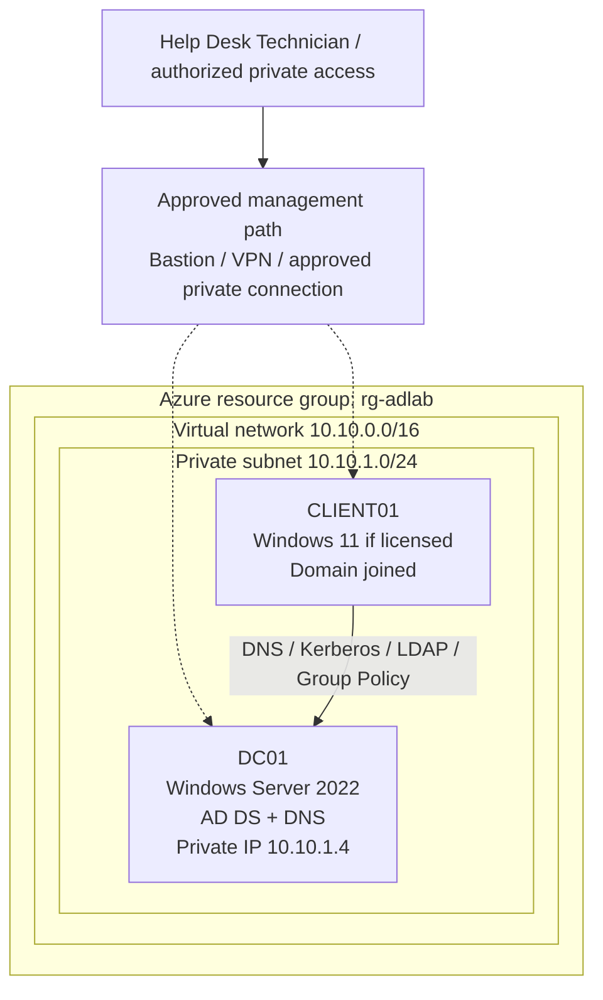

# Enterprise Active Directory Help Desk Lab

**Portfolio status: Repository starter / planned lab — no Azure VMs, domain controller, domain join, or help desk tickets have been executed.**

A practical enterprise IT support simulation built around **Windows Server Active Directory Domain Services (AD DS)**, **DNS**, **Windows 11**, **Group Policy**, **Jira-style ticket handling**, and safe PowerShell automation. The goal is to demonstrate the daily responsibilities of a Tier 1 Help Desk / Desktop Support Technician through reproducible tasks and **verified** troubleshooting evidence.

> **Business scenario (fictional):** The support desk serves a 25-person organization with IT, HR, Engineering, Security and Contractors. Support requests cover identity lifecycle, password resets, lockouts, login failures, domain join, group-based access, DNS and Group Policy. No real employee data is used.

## Quick status

| Capability | Planned work | Verified implementation |
| --- | --- | --- |
| Azure lab foundation | Resource group, VNet, NSGs, budget/teardown review | **Not deployed** |
| Identity | Windows Server 2022 DC01, AD DS, `adlab.test`, DNS | **Not configured** |
| Client | CLIENT01, Windows 11 domain joined (subject to eligibility) | **Not deployed** |
| Directory administration | Five OUs, role groups, 25 fake user accounts | Sample CSV only; **not created in AD** |
| Endpoint / policy | GPO restrictions, domain join/rejoin, permissions | **Not configured or tested** |
| Service desk | Twelve real-world scenario templates and ticket notes | Scenarios authored; **not executed** |
| Automation | PowerShell plan/dry-run user creation, read-only reporting | Source code only; execution evidence pending |
| Quality controls | Static tests and GitHub Actions | Checks run after publication; no results claimed here |

## Planned environment — Azure IaaS hosting traditional AD DS



The architecture above is a **design proposal**, not evidence that the Azure resources or network paths work. This uses self-managed Windows Server AD DS in Azure VMs; it is **not Microsoft Entra ID** and **not Microsoft Entra Domain Services**. Use a private static Azure NIC address for DC01, configure the VNet DNS resolver for the DC, and refresh DHCP/DNS settings on clients. Avoid exposing RDP (TCP 3389) or domain-controller ports to the internet. [Full design](architecture/README.md).

**Windows 11 licensing gate:** Windows 11 on Azure has licensing and dev/test eligibility requirements. Validate your subscription, image rights and VM sizing with Microsoft's current guidance before deployment. If ineligible, use an appropriately licensed client lab rather than assuming Azure Windows 11 is available. [Lab setup](docs/deployment/AZURE_DEPLOYMENT_PLAN.md).

## Planned Active Directory structure

- **Domain:** `adlab.test` (reserved example `.test` namespace for an isolated lab).
- **OUs:** `IT`, `HR`, `Engineering`, `Security`, `Contractors`.
- **Role groups:** `GG-IT-Admins`, `GG-HR-Users`, `GG-Engineering-Users`, `GG-Security-Users`, `GG-Contractors`, and `GG-VPN-Users`.
- **Test identities:** [25 entirely fictional accounts](data/lab-users.csv), seeded only after authorized lab deployment.

## Help Desk skills to demonstrate

1. Identity verification and account unlocks or password resets using approved procedures.
2. Onboarding, department transfers, access group changes and offboarding.
3. Diagnosing domain sign-in failures without randomly resetting accounts.
4. Testing DNS A/CNAME resolution, secure domain joins and Group Policy application.
5. Handling permission issues and distinguishing share permissions from NTFS permissions.
6. Recording ticket intake, business impact, investigation, remediation, verification, escalation and closure.
7. Safe PowerShell admin scripting with explicit execution approval and no hard-coded passwords.

## Core lab workflow

**Learn → Build → Troubleshoot → Explain → Repeat.** Complete each ticket in guided mode, repeat with fewer hints, then perform a blind break/fix and an interview summary. Use the [ticket index](docs/tickets/README.md), [project roadmap](PROJECT_ROADMAP.md), and [tracker](PROJECT_TRACKER.md). Keep every phase **Not Started** until real implementation and verification are complete.

### Safe initial local checks (no Azure account required)

```bash
python3 -m unittest discover -s tests -p 'test_*.py' -v
```

PowerShell examples are [documented here](scripts/powershell/README.md). `New-LabUsers.ps1` is **preview-only by default** and requires explicit `-Execute` to create **disabled** accounts in an authorized AD lab. No passwords, live identities, or Azure deployment credentials are in this repository.

## Project roadmap and navigation

| Location | Contents |
| --- | --- |
| [PROJECT_ROADMAP.md](PROJECT_ROADMAP.md) | Milestone-by-milestone build and evidence gates |
| [PROJECT_TRACKER.md](PROJECT_TRACKER.md) | Verified status/evidence log |
| [architecture/](architecture/README.md) | AD architecture, network and permission boundaries |
| [docs/deployment/](docs/deployment/README.md) | Azure account/VM/AD prerequisites, approval and teardown |
| [docs/tickets/](docs/tickets/README.md) | Twelve help desk scenario specifications |
| [docs/runbooks/](docs/runbooks/README.md) | Repeatable onboarding, lockout, DNS and incident workflows |
| [docs/group-policy/](docs/group-policy/README.md) | GPO objectives and verification methods |
| [scripts/powershell/](scripts/powershell/README.md) | Safe AD PowerShell lab scripts |
| [data/](data/README.md) | Synthetic user-data seed and schema |
| [screenshots/](screenshots/README.md) | Sanitized screenshots and evidence handling |
| [docs/portfolio/](docs/portfolio/CASE_STUDY.md) | Interview case study with actual-evidence placeholders |
| [COST_AND_SECURITY.md](COST_AND_SECURITY.md) | Azure spend, security and teardown guardrails |

## Definition of done

A completed ticket must include: user identity verification (when relevant), symptoms and scope, least-privilege assessment, relevant commands/GUI paths, evidence of investigation, change authorization, result and validation, accurate ticket notes, and a short interview explanation. Never invent deployments, successful tests, resolved tickets, or certification results.

## Current project status

**Repository foundation prepared; cloud lab not deployed; no Azure spend claimed.** After the GitHub repository is created, this starter can be published and enhanced incrementally. The first real milestone is account eligibility, estimated cost and safe access planning, not spinning up paid servers.

### Primary Microsoft references

- [Install AD DS on Azure VM](https://learn.microsoft.com/en-us/windows-server/identity/ad-ds/deploy/virtual-dc/adds-on-azure-vm)
- [Windows 11 Azure eligibility](https://learn.microsoft.com/en-us/azure/virtual-machines/windows/windows-desktop-multitenant-hosting-deployment)
- [Azure budget alerts](https://learn.microsoft.com/en-us/azure/cost-management-billing/costs/tutorial-acm-create-budgets)
