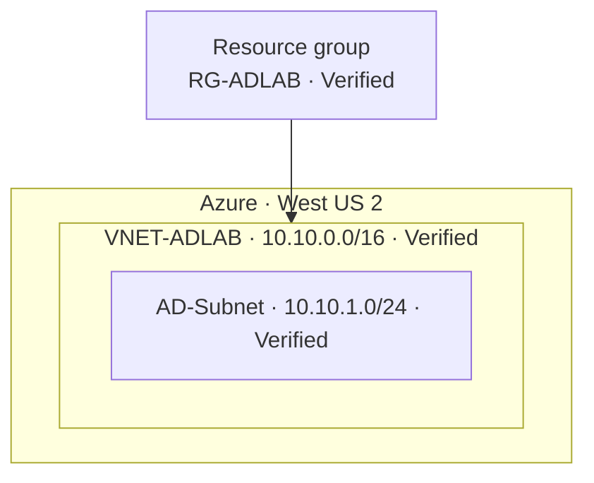

# Azure Cloud Network Architecture Lab

**Azure infrastructure and networking portfolio** | Resource organization · CIDR subnetting · network segmentation · security controls · future multi-zone resiliency

**Project status (October 19, 2026):** Resource group, virtual network and one subnet **deployed and screenshot-verified**. A proposed higher-availability multi-tier topology is **design-only, not deployed**.

## Overview

This hands-on lab starts with an Azure virtual network and evolves toward an enterprise-style cloud architecture with a public-facing entry point, private application tier, security boundaries, routing and workloads distributed across availability zones.

It demonstrates my growing understanding of cloud networking by distinguishing **implemented configuration**, **validated behavior** and **future architectural designs**. This is **not** an Active Directory or Windows Server project.

## Phase 1 — Verified infrastructure

| Resource | Observed configuration | Evidence |
| --- | --- | --- |
| Resource group | `RG-ADLAB` | [Resource group created](screenshots/02-resource-group-created.png) |
| Region | West US 2 | [VNet overview](screenshots/05-vnet-overview-.png) |
| Virtual network | `VNET-ADLAB` | [Deployment succeeded](screenshots/04-vnet-deployment-success.png) |
| Address space | `10.10.0.0/16` | [VNet overview](screenshots/05-vnet-overview-.png) |
| First subnet | `AD-Subnet`, `10.10.1.0/24` | [Verified subnet](screenshots/06-ad-subnet-verified.png) |
| Subnet capacity | 251 Azure-assignable addresses | [Verified subnet](screenshots/06-ad-subnet-verified.png) |
| DNS | Azure-provided DNS | [VNet overview](screenshots/05-vnet-overview-.png) |
| Subnet NSG | No association shown | [Verified subnet](screenshots/06-ad-subnet-verified.png); **not evidence of hardened isolation** |

The initial resource names include `AD` because these Azure resources were originally named for another proposed lab. They are preserved verbatim to match real deployment evidence. No directory service or VM was deployed in the verified Azure phase.

### Deployed network map

## Phase 2 — Proposed enterprise network

**All elements below beyond the existing VNet and first subnet are planned.** Future development will add:

- A **public-facing HTTPS ingress layer** (e.g. Application Gateway with WAF where appropriate).
- **Private application workloads** without direct public IPs.
- **Private data access**, private DNS and controlled outbound routing.
- **NSGs**, least-privilege access and effective-route verification.
- **Two Azure Availability Zones** for redundant application instances where the subscription and selected SKUs support them.
- Health probes, monitoring, simulated instance failure, recovery testing and documented teardown.

See [the architecture proposal](architecture/TARGET_ARCHITECTURE.md). In Azure, **VNets and subnets are regional**, not availability-zone-specific. The future zonal *resources* span zones while connecting to regional subnets.

## Roadmap and evidence gates

| Milestone | Status |
| --- | --- |
| Resource group, VNet, `/16` address plan, initial `/24` subnet | **Deployed / verified** |
| Diagram of edge, app and data tiers with explicit traffic rules | **Planned** |
| Additional subnets, NSGs, route tables | Not started |
| Public-facing load-balancing tier and private application instances | Not started |
| Deployment across two availability zones | Not started |
| Failover/health checks, monitoring, logging | Not started |
| IaC deployment, cost audit and teardown | Not started |

[Tracker](PROJECT_TRACKER.md) · [Cost and security](docs/COST_AND_SECURITY.md)

## Evidence

The [six sanitized Azure screenshots](screenshots/README.md) capture configuration, deployment confirmation and actual post-deployment inspection. Configuration screens alone are not proof that a service exists; separate post-deployment verification is provided.

## Repository navigation

- [Verified architecture](architecture/CURRENT_ARCHITECTURE.md)
- [Future high-availability architecture](architecture/TARGET_ARCHITECTURE.md)
- [Build record](docs/IMPLEMENTATION.md)
- [Verification](docs/VALIDATION.md)
- [Networking concepts](docs/NETWORKING_CONCEPTS.md)
- [Lessons learned](docs/LESSONS_LEARNED.md)
- [Cost and security](docs/COST_AND_SECURITY.md)
- [Portfolio case study](docs/CASE_STUDY.md)
- [Screenshots](screenshots/README.md)

**Note on history:** The earlier unimplemented project material was removed from the default branch to keep this portfolio honest and focused; its original state is preserved in the [archive branch](../../tree/archive/active-directory-original). Historical resource names in screenshots are retained rather than falsified.
