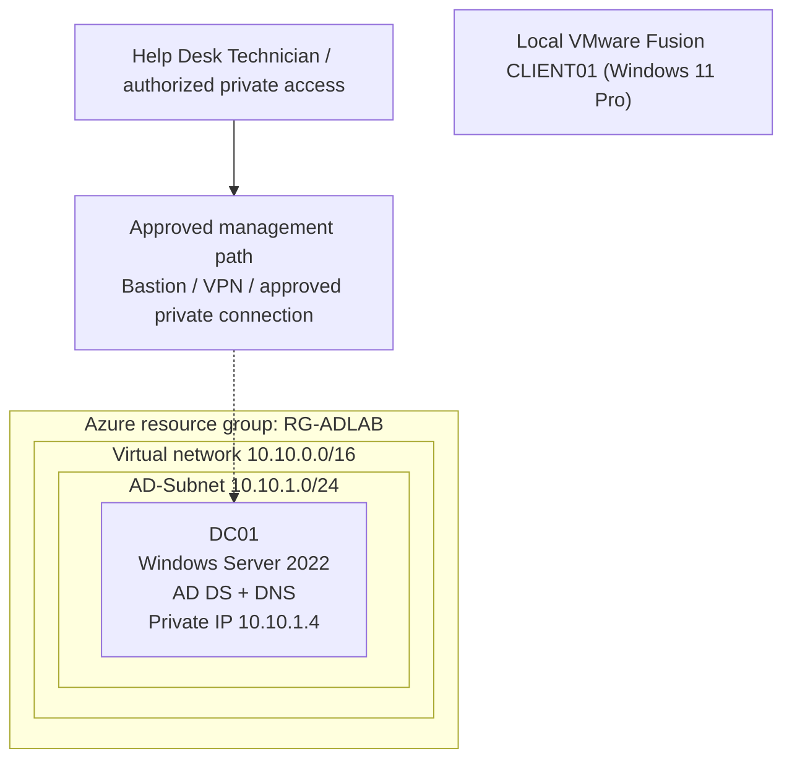

# Enterprise Active Directory Help Desk Lab

**Portfolio status: Phase 0 in progress. RG-ADLAB is verified from user-supplied Azure screenshots. No VNet, DC01, AD DS, secure local-client link or completed ticket has been verified.**

A practical enterprise IT support simulation built around **Windows Server Active Directory Domain Services (AD DS)**, **DNS**, **Windows 11**, **Group Policy**, **Jira-style ticket handling**, and safe PowerShell automation. The goal is to demonstrate the daily responsibilities of a Tier 1 Help Desk / Desktop Support Technician through reproducible tasks and **verified** troubleshooting evidence.

> **Business scenario (fictional):** **Apex Technologies** is a proposed ~50-employee company with IT, Finance, Human Resources, Sales, Operations and Management departments. The original 25-user, five-department test-data CSV remains intact but is not yet imported; it will be revised after the AD OU design is approved. No real employee data is used.

## Quick status

| Capability | Planned work | Verified implementation |
| --- | --- | --- |
| Azure lab foundation | RG-ADLAB, VNET-ADLAB, AD-Subnet, NSGs, budget/teardown review | **RG-ADLAB verified** from screenshots; VNet/subnet **not verified** |
| Identity | Windows Server 2022 DC01, AD DS, `adlab.test`, DNS | **Not configured** |
| Client | CLIENT01, user-reported local VMware Fusion Windows 11 Pro client | VM setup **user-reported**; Azure connectivity/domain join not verified |
| Directory administration | Proposed 6 departmental OUs, role groups, ~50 fictional users (existing 25-user seed preserved) | **Design only**; no AD accounts created |
| Endpoint / policy | GPO restrictions, domain join/rejoin, permissions | **Not configured or tested** |
| Service desk | Twelve real-world scenario templates and ticket notes | Scenarios authored; **not executed** |
| Automation | PowerShell plan/dry-run user creation, read-only reporting | Source code only; execution evidence pending |
| Quality controls | Static tests and GitHub Actions | [Initial offline CI run passed](https://github.com/dbates91/enterprise-active-directory-helpdesk-lab/actions/runs/38294061409); no AD or Azure validation claimed |

## Planned environment — Azure IaaS hosting traditional AD DS



The architecture above is a **design proposal**, not evidence that the Azure resources or network paths work. This uses self-managed Windows Server AD DS in Azure VMs; it is **not Microsoft Entra ID** and **not Microsoft Entra Domain Services**. Use a private static Azure NIC address for DC01, configure the VNet DNS resolver for the DC, and refresh DHCP/DNS settings on clients. Avoid exposing RDP (TCP 3389) or domain-controller ports to the internet. [Full design](architecture/README.md).

**Windows 11 client:** CLIENT01 is a user-reported local VMware Fusion Windows 11 Pro installation. Verify the local Windows license and private Azure routing; do **not** deploy a second paid Azure Windows VM merely to satisfy the design. If considering an Azure-hosted client later, evaluate licensing/eligibility first. [Lab setup](docs/deployment/AZURE_DEPLOYMENT_PLAN.md).


**Connectivity design correction:** The Windows 11 Pro client is **local to VMware Fusion** and is not part of an Azure subnet. It requires an approved routed/VPN connection and DNS configuration to join `adlab.test`; paid VPN Gateway/Bastion or a second Azure VM must not be provisioned without cost/licensing review. No tunnel is verified.

## Planned Active Directory structure

- **Domain:** `adlab.test` (reserved example `.test` namespace for an isolated lab).
- **Proposed Apex Technologies departments:** `IT`, `Finance`, `HumanResources`, `Sales`, `Operations`, `Management`, with dedicated Users/Groups/Computers containers; see [new OU proposal](docs/academy/APEX_TECHNOLOGIES.md).
- **Proposed role groups:** `GG-IT-Support`, `GG-Finance-Users`, `GG-HR-Users`, `GG-Sales-Users`, `GG-Operations-Users`, `GG-Management-Users`; existing legacy CSV group values preserved as historical seed data.
- **Test identities:** [25 old fictional seed records](data/lab-users.csv) are kept as source samples; new ~50-user roster to be developed before lab import. No AD accounts currently verified.

## Help Desk skills to demonstrate

1. Identity verification and account unlocks or password resets using approved procedures.
2. Onboarding, department transfers, access group changes and offboarding.
3. Diagnosing domain sign-in failures without randomly resetting accounts.
4. Testing DNS A/CNAME resolution, secure domain joins and Group Policy application.
5. Handling permission issues and distinguishing share permissions from NTFS permissions.
6. Recording ticket intake, business impact, investigation, remediation, verification, escalation and closure.
7. Safe PowerShell admin scripting with explicit execution approval and no hard-coded passwords.

## Core lab workflow

**Learn → Build → Troubleshoot → Explain → Repeat.** Complete each ticket in guided mode, repeat with fewer hints, then perform a blind break/fix and an interview summary. Use the [ticket index](docs/tickets/README.md), [project roadmap](PROJECT_ROADMAP.md), and [tracker](PROJECT_TRACKER.md). Keep every phase **Not Started** until real implementation and verification are complete.

### Safe initial local checks (no Azure account required)

```bash
python3 -m unittest discover -s tests -p 'test_*.py' -v
```

PowerShell examples are [documented here](scripts/powershell/README.md). `New-LabUsers.ps1` is **preview-only by default** and requires explicit `-Execute` to create **disabled** accounts in an authorized AD lab. No passwords, live identities, or Azure deployment credentials are in this repository.

## Project roadmap and navigation

| Location | Contents |
| --- | --- |
| [PROJECT_ROADMAP.md](PROJECT_ROADMAP.md) | Milestone-by-milestone build and evidence gates |
| [Step 2 — Azure VNet and subnet](architecture/STEP_02_VNET_AND_SUBNET.md) | Current approved learning task: create `VNET-ADLAB` and `AD-Subnet` |
| [30-day Enterprise Help Desk Academy](docs/academy/README.md) | 30 days, seven categories, 30 tickets, three difficulty levels, scoring and final assessment |
| [PROJECT_TRACKER.md](PROJECT_TRACKER.md) | Verified status/evidence log |
| [architecture/](architecture/README.md) | AD architecture, network and permission boundaries |
| [docs/deployment/](docs/deployment/README.md) | Azure account/VM/AD prerequisites, approval and teardown |
| [docs/tickets/](docs/tickets/README.md) | Twelve help desk scenario specifications |
| [docs/runbooks/](docs/runbooks/README.md) | Repeatable onboarding, lockout, DNS and incident workflows |
| [docs/group-policy/](docs/group-policy/README.md) | GPO objectives and verification methods |
| [scripts/powershell/](scripts/powershell/README.md) | Safe AD PowerShell lab scripts |
| [data/](data/README.md) | Synthetic user-data seed and schema |
| [screenshots/](screenshots/README.md) | Sanitized screenshots and evidence handling |
| [docs/portfolio/](docs/portfolio/CASE_STUDY.md) | Interview case study with actual-evidence placeholders |
| [COST_AND_SECURITY.md](COST_AND_SECURITY.md) | Azure spend, security and teardown guardrails |

## Definition of done

A completed ticket must include: user identity verification (when relevant), symptoms and scope, least-privilege assessment, relevant commands/GUI paths, evidence of investigation, change authorization, result and validation, accurate ticket notes, and a short interview explanation. Never invent deployments, successful tests, resolved tickets, or certification results.

## Current project status

**Resource group verified from screenshots; network, VM/domain deployment, secure client connectivity and ticket resolution remain unverified. Offline repository checks passed; no Azure VM spend claimed.** Proceed through the [eight GitHub phase issues](https://github.com/dbates91/enterprise-active-directory-helpdesk-lab/issues) and verify licensing, security and costs before any VM deployment. The first real milestone is account eligibility, estimated cost and safe access planning, not spinning up paid servers.

### Primary Microsoft references

- [Install AD DS on Azure VM](https://learn.microsoft.com/en-us/windows-server/identity/ad-ds/deploy/virtual-dc/adds-on-azure-vm)
- [Windows 11 Azure eligibility](https://learn.microsoft.com/en-us/azure/virtual-machines/windows/windows-desktop-multitenant-hosting-deployment)
- [Azure budget alerts](https://learn.microsoft.com/en-us/azure/cost-management-billing/costs/tutorial-acm-create-budgets)
