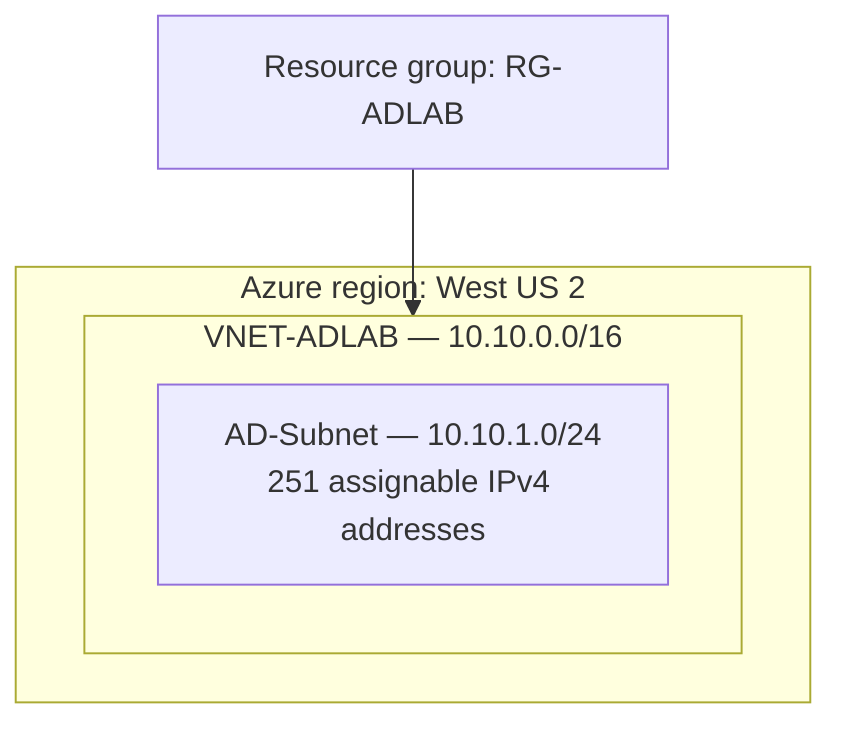

# Verified Current Architecture

**Verified from Azure Portal screenshots, October 19, 2026.**

| Setting | Verified value |
| --- | --- |
| Resource group | `RG-ADLAB` |
| VNet / region | `VNET-ADLAB` / West US 2 |
| Network space | `10.10.0.0/16` |
| Subnet | `AD-Subnet` / `10.10.1.0/24` |
| VNet DNS | Azure-provided DNS |
| NSG on subnet | No association shown |
| VMs, gateways, public IPs, load balancers | **None demonstrated** |

Azure reserves five IP addresses per subnet: first four and last. The first potentially assignable address in this subnet is `10.10.1.4`; it is **not** documented as allocated to a VM.

**Scope:** An existing subnet name contains `AD` for historical reasons; no directory service is part of this project.

- [Resource group evidence](../screenshots/02-resource-group-created.png)
- [VNet overview](../screenshots/05-vnet-overview-.png)
- [Subnet verification](../screenshots/06-ad-subnet-verified.png)

[Proposed next architecture](TARGET_ARCHITECTURE.md)
