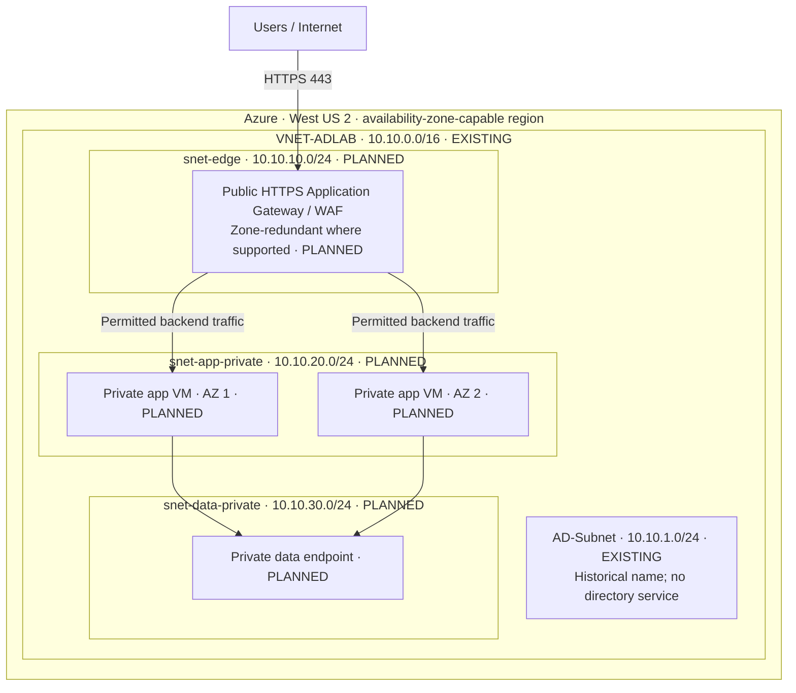

# Proposed Azure Architecture — Multi-Tier and Multi-Zone

> **DESIGN ONLY.** This diagram is a proposed learning milestone; it is not proof of deployed resources. Only the VNet and `AD-Subnet` in the diagram currently have verification evidence.

## Conceptual layout

### CIDR plan

| Layer | IPv4 allocation | Deployment status | Purpose |
| --- | --- | --- | --- |
| Regional VNet | `10.10.0.0/16` | **Verified** | Address space for segmented services |
| Original subnet | `10.10.1.0/24` | **Verified** | Existing foundational subnet; no verified workload |
| Edge subnet | `10.10.10.0/24` | **Planned** | Dedicated Application Gateway subnet |
| Private application | `10.10.20.0/24` | **Planned** | App backends without public IPs |
| Private data | `10.10.30.0/24` | **Planned** | Private endpoints and restricted data connectivity |

**Azure design principle:** VNets and subnets are **regional**, not zone-scoped. Azure availability zones apply to compatible zonal *compute and service instances*. Therefore placing private app VMs in AZ 1 and AZ 2 does not require AWS-style AZ-bound subnet objects.

### Expected traffic controls — must be tested later

| Flow | Purpose | Planned security validation |
| --- | --- | --- |
| Internet → gateway frontend | Public HTTPS | WAF / TLS and approved inbound 443 only |
| Gateway → private app backends | Healthy application delivery | Restricted NSG rules, health probes, no public app IP |
| App → private data | Business logic access | Private DNS, service permissions, reject public data endpoint |
| Administration → private app | Operational control | Authorized identity-based access; no unrestricted 22/3389 |
| Private app → required endpoints | Package/patch/API egress | Deliberate outbound plan, effective routes and expense review |

### Future high-availability testing

1. Validate regional zone support and available VM/gateway SKUs under the subscription.
2. Place at least two private app instances in **different Azure availability zones**, when supported.
3. Use a compatible multi-zone/zone-redundant entry service and confirm actual zone settings.
4. Configure backend probes and deliberately disable one **nonproduction** app VM to measure how traffic responds.
5. Validate the data tier separately. Two app instances do **not** make a database or complete application automatically highly available.
6. Collect network/health logs and cleanup evidence. Record observed results, not theoretical SLAs.

**Cost warning:** Application Gateway/WAF, NAT Gateway, public IPs, persistent VMs, data services, and logging can incur ongoing charges. This lab will stage features only after pricing and teardown plans are reviewed.

[Current verified topology](CURRENT_ARCHITECTURE.md) · [Cost guardrails](../docs/COST_AND_SECURITY.md)
